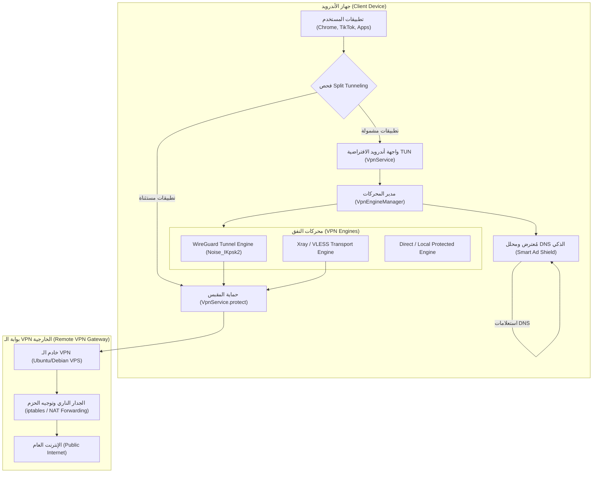
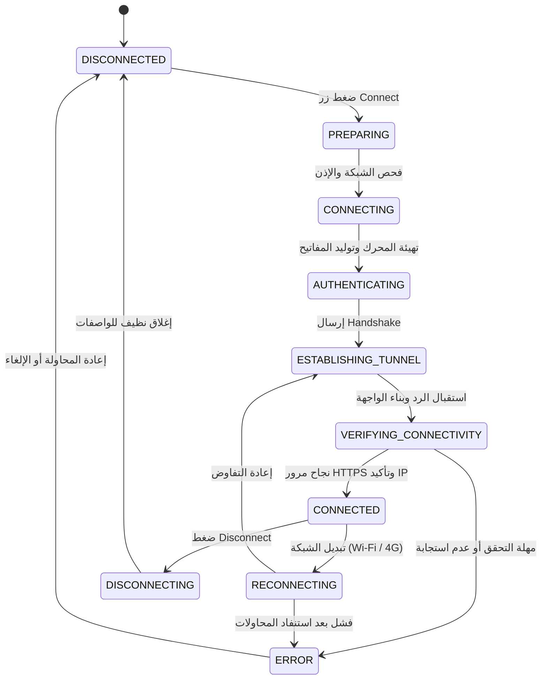

# ARCHITECTURE.md
## Ultimate Android VPN: المعمارية الهندسية ومخطط التدفق

### 1. الرؤية المعمارية (Architectural Overview)
تمت إعادة هيكلة التطبيق ليعمل كـ **Production-Grade Android VPN** حقيقي متعدد البروتوكولات، يدمج بين حماية التشفير الكاملة لحركة الإنترنت، تجاوز الحجب والرقابة، فلترة الإعلانات الذكية على مستوى DNS دون كسر منصات الفيديو (YouTube / TikTok)، وتوفير تحكم دقيق في تقسيم النفق (Split Tunneling).

---

### 2. تدفق البيانات ثنائي الاتجاه (Bidirectional Packet Flow)

#### أ. مسار الإرسال (Outbound Packet Flow):
1. التطبيقات تُنشئ اتصالات TCP/UDP.
2. مكدس شبكة أندرويد يوجه الحزم ذات العناوين المشمولة إلى واجهة TUN (`tun0`).
3. خيط القراءة (`TunReaderThread`) يسحب الحزمة الخام من `FileInputStream(tunPfd.fileDescriptor)`.
4. إذا كانت الحزمة موجهة لمنفذ DNS (Port 53):
   - يتم فحص النطاق مقابل القوائم المدمجة وقواعد منع الإعلانات.
   - إذا كان نطاق إعلاني صريح: يتم الرد محلياً بـ `NULL_IP` أو `NXDOMAIN` دون استهلاك بيانات النفق.
   - إذا كان نطاقاً شرعياً أو تابعاً لمنصات الفيديو: يتم تمريره للحل عبر خادم DNS المخصص داخل النفق.
5. حزم البيانات العادية (HTTP, HTTPS, QUIC):
   - يتم تشفيرها وفق مفاتيح الجلسة (ChaCha20-Poly1305 لـ WireGuard).
   - يتم وضعها داخل حزم UDP ونقلها عبر المقبس الفيزيائي المحمي `protect(socket)`.
6. يستقبل خادم الـ Gateway الحزمة، يفك التشفير، ويجري عملية NAT ثم يرسلها للإنترنت العام.

#### ب. مسار الاستقبال (Inbound Packet Flow):
1. يعود الرد من الإنترنت إلى خادم الـ VPN.
2. يغلف الخادم الرد داخل حزمة مشفرة ويرسلها إلى IP ومنفذ الهاتف.
3. يستقبل خيط الاستقبال في التطبيق الحزمة من المقبس المحمي.
4. يتحقق المحرك من صحة التشفير ومطابقة عدادات التسلسل (Replay Protection).
5. يتم فك التشفير واستخراج حزمة IP الأصلية.
6. تُكتب الحزمة في واجهة الـ TUN عبر `FileOutputStream(tunPfd.fileDescriptor)` لتصل للتطبيق المعني.

---

### 3. آلة الحالات الموحدة (Unified State Machine)
يعتمد التطبيق آلة حالات صارمة لا تدّعي الاتصال الناجح إلا بعد إثبات نقل البيانات والتحقق من العنوان العام:

---

### 4. تقسيم النفق الذكي (Split Tunneling Architecture)
* وضع **جميع التطبيقات (All Apps)**: يوجه كافة حركات الجهاز عبر النفق (`0.0.0.0/0` و `::/0`).
* وضع **تطبيقات محددة (Selected Apps)**: يستخدم `builder.addAllowedApplication(pkg)` لتمرير التطبيقات المختارة فقط (مثل TikTok والمتصفح).
* وضع **استثناء تطبيقات (Excluded Apps)**: يستخدم `builder.addDisallowedApplication(pkg)` لتمرير كافة التطبيقات باستثناء التطبيقات الحساسة (مثل تطبيقات البنوك المحلية).
> **ملاحظة أمان هامة:** لا يتم أبداً استدعاء `addAllowedApplication` و `addDisallowedApplication` معاً في نفس باني الـ VpnService تفادياً لحدوث استثناء في نظام أندرويد.

---

### 5. حماية التسرب ومفتاح القفل (Leak Protection & Kill Switch)
* **IPv6 Leak Protection:** يتم إضافة بادئة `::/0` وتوجيه IPv6 لمنع تسرب الحزم خارج النفق.
* **DNS Leak Protection:** إجبار جميع استعلامات DNS على المرور عبر الخادم الافتراضي المحمي للنفق ومنع استعلام خوادم مزود الخدمة المحلي.
* **Android Always-on VPN & Lockdown:** دعم نظام أندرويد المدمج لمنع أي اتصال بالإنترنت في حال انقطاع الـ VPN.
